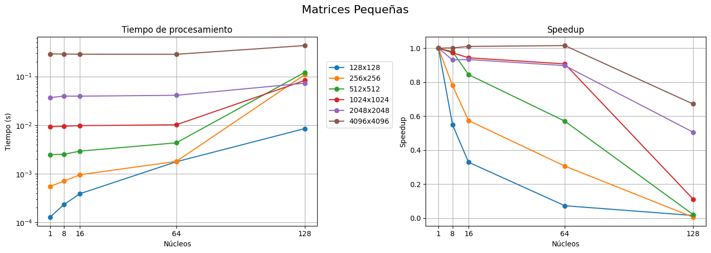
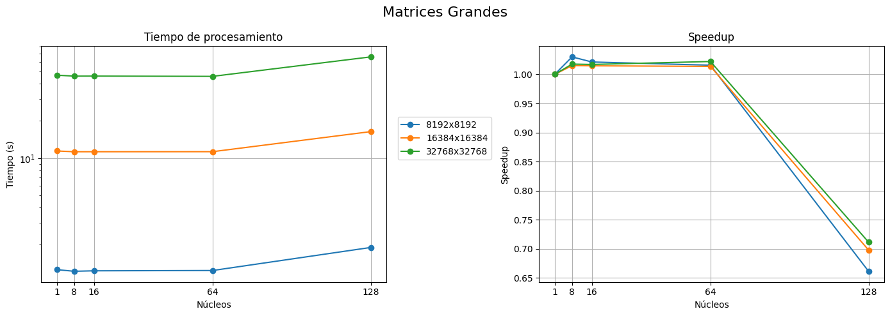
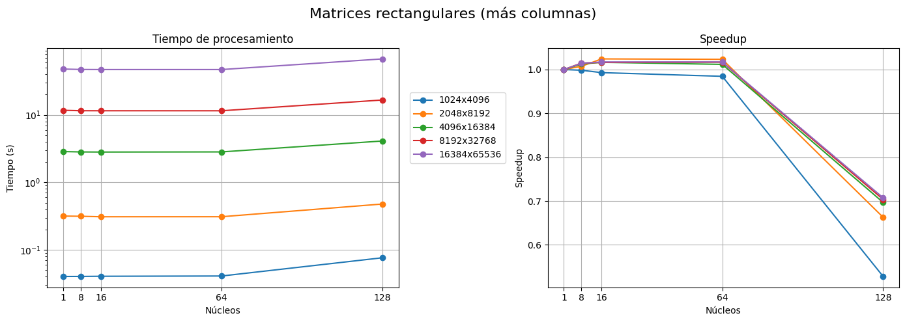
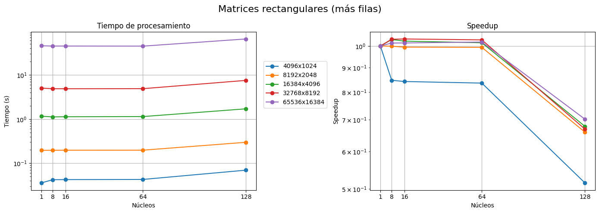
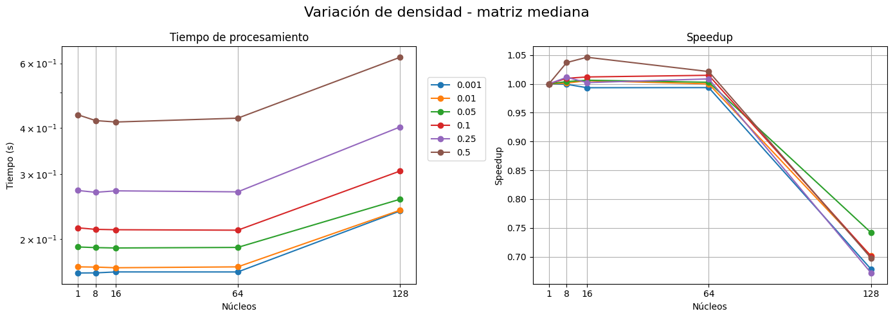

# Multiplicación vector–matriz dispersa en paralelo con MPI

Proyecto 9: *Multiplicación Matriz por Vector con Matriz Dispersa*.

Implementación en C de la multiplicación de un vector por una matriz dispersa almacenada en formato **CSC** (*Compressed Sparse Column*), paralelizada con **MPI** mediante una distribución por columnas.

## Índice

1. [Introducción](#1-introducción)
2. [Construcción y ejecución](#2-construcción-y-ejecución)
3. [Población de la matriz](#3-población-de-la-matriz)
4. [Compresión de la matriz (CSC)](#4-compresión-de-la-matriz-csc)
5. [Paralelización: distribución de columnas](#5-paralelización-distribución-de-columnas)
6. [Comunicación entre procesos](#6-comunicación-entre-procesos)
7. [La multiplicación](#7-la-multiplicación)
8. [Mediciones](#8-mediciones)
9. [Conclusiones](#9-conclusiones)
10. [Limitaciones y posibles mejoras](#10-limitaciones-y-posibles-mejoras)
11. [Bibliografía](#11-bibliografía)

## Participantes

- **Villa, Benjamín**
- **Santillán Plasencia, Gonzalo**

---

## 1. Introducción

En muchos sistemas de gran escala aparecen matrices con un porcentaje muy alto de ceros, conocidas como **matrices dispersas**. Guardarlas completas desperdicia memoria, y multiplicarlas directamente desperdicia mucho cómputo, porque casi todas las operaciones son del tipo `0 · x`, que no aportan nada al resultado.

Nuestro objetivo es almacenar únicamente los valores de los **elementos no nulos** y su posición, para así utilizar solo esos elementos al multiplicar.

### Operación que se resuelve

Dada una matriz `A` de `N` filas y `M` columnas, y un vector `v` de dimensión `N`, se calcula el vector `r` de dimensión `M`:

$$
r[j] = \sum_{i=0}^{N-1} v[i] \cdot A[i][j] \qquad \text{para } j = 0, \dots, M-1
$$

Se eligió esta forma porque en el formato CSC los datos de una columna están contiguos: cada elemento de `r` se calcula recorriendo una sola columna.

### Resumen de la solución propuesta

| Etapa | Qué se hace |
|---|---|
| Población | El proceso 0 genera una matriz aleatoria con una densidad dada y un vector aleatorio. |
| Compresión | El proceso 0 convierte la matriz al formato CSC. |
| Distribución | Las `M` columnas se reparten en bloques contiguos entre los procesos. |
| Comunicación | `MPI_Bcast` para el vector, `MPI_Scatterv` para la matriz comprimida y `MPI_Gatherv` para el resultado. |
| Cálculo | Cada proceso multiplica solo sus columnas, sobre su porción local de la matriz. |

### Estructura de archivos del proyecto

| Archivo | Contenido |
|---|---|
| `config.h` | Verificación de macros y definición de `llint` (`long long int`). |
| `utils.c` / `utils.h` | Población de la matriz y del vector, y funciones para mostrarlos. |
| `parallel_utils.c` / `parallel_utils.h` | Compresión CSC, multiplicación CSC, reparto de columnas y cálculo de conteos y desplazamientos. |
| `mxv_parallel.c` | Programa paralelo (MPI). |
| `mxv_sequential.c` | Programa secuencial de referencia, con la matriz densa. |
| `Dockerfile` | Configuración de un entorno aislado con MPI. |
| `makefile` | Automatiza la compilación y la ejecución de ambos programas. |
| `benchmark.sh` | Ejecuta las pruebas de rendimiento y guarda los tiempos en archivos de log para su análisis posterior. |

---

## 2. Construcción y ejecución

Los programas pueden compilarse y ejecutarse de dos maneras:

1. Con **`make`**, que es la forma más simple si ya se cuenta con MPI.
2. Con **`mpicc`** de forma manual.

Para ambas opciones se necesita una implementación de MPI instalada (se puede utilizar el `Dockerfile` para crear una imagen con Open MPI) y un compilador de C. Para la primera opción se necesita además `make`.

### Parámetros

Todos los parámetros se fijan en tiempo de compilación mediante macros del preprocesador (`-D`). El archivo `config.h` produce un error de compilación si falta `N`, `M`, `RAND_N` o `M_DENSITY`. Con `make`, estos mismos nombres son variables que se pueden modificar desde la línea de comandos.

| Parámetro | Significado | Valor por defecto (`make`) |
|---|---|---|
| `N` | Cantidad de filas de la matriz y dimensión del vector `v`. | `20` |
| `M` | Cantidad de columnas de la matriz y dimensión del vector resultado `r`. | `20` |
| `M_DENSITY` | Densidad: fracción de elementos no nulos de la matriz. Varía entre `0.0` y `1.0`. | `0.3` |
| `RAND_N` | Límite superior (excluido) de los valores aleatorios. Debe ser al menos `2`. | `10` |
| `CORES` | Cantidad de procesos MPI de la versión paralela. Solo existe en `make`. | `4` |

Con `RAND_N = k`, los elementos del vector `v` toman valores entre `0` y `k - 1`, y los elementos no nulos de la matriz toman valores entre `1` y `k - 1`.

Al trabajar con matrices grandes es necesario agregar el sufijo `LL` a los valores de `N` y `M` (por ejemplo, `N=65536LL`). Esto se debe a que en una parte del código se multiplican entre sí, y el resultado puede desbordar el rango de un `int` (cuando `N · M` supera 2 147 483 647). Con el sufijo `LL` la operación se realiza con el tipo `long long int`.

### Docker (opcional)

Para quienes no tengan instaladas las dependencias de MPI y solo quieran probar el programa, el proyecto incluye un `Dockerfile` basado en Ubuntu 22.04 con Open MPI, el compilador de C y `make`. Es necesario tener instalado [Docker](https://www.docker.com/products/docker-desktop/).

Desde la carpeta del proyecto, se construye la imagen:

```bash
docker build -t mpienv .
```

Y luego se inicia el contenedor:

```bash
docker run -it mpienv
```

En Linux puede ser necesario anteponer `sudo` a ambos comandos.

El primer comando crea la imagen `mpienv`, que copia los archivos del proyecto en el directorio `/app`. El segundo abre una terminal dentro del contenedor, ya ubicada en `/app`, desde donde se puede usar `make` como se explica en la siguiente sección.

Los cambios que se hagan en el código fuente después de construir la imagen no se reflejan dentro del contenedor.

### Compilación y ejecución con `make`

Para compilar y ejecutar la multiplicación **en paralelo**:

```bash
make parallel
```

Para la versión **secuencial**:

```bash
make sequential
```

Ambos objetivos tienen alias: `parallel` también puede invocarse como `pll` o `p`, y `sequential` como `seq` o `s`.

Cada comando compila el programa correspondiente (`mxv_parallel.out` o `mxv_sequential.out`) y lo ejecuta con `mpirun`: la versión paralela con `CORES` procesos y la secuencial con un único proceso. Se usa la opción `--allow-run-as-root` para que funcione dentro del contenedor de Docker, donde se trabaja como usuario root.

Los parámetros de la tabla anterior se modifican al invocar `make`. Por ejemplo, para multiplicar en paralelo, con 8 procesos, un vector de dimensión 1000 por una matriz de 1000 filas y 5000 columnas, con una densidad del 10 % y valores de hasta 10:

```bash
make p N=1000 M=5000 M_DENSITY=0.1 RAND_N=11 CORES=8
```

> **Nota:** Open MPI no permite lanzar más procesos que núcleos disponibles. Si `CORES` supera esa cantidad, `mpirun` termina con un error. Se puede forzar la ejecución agregando `--oversubscribe` al comando `mpirun` del `makefile`, pero en ese caso los procesos compiten por los núcleos y los tiempos medidos dejan de ser representativos.

### Compilación manual con `mpicc`

Si no se quiere usar `make`, los programas se compilan y ejecutan directamente con MPI. Las macros se definen con `-D`.

Versión paralela:

```bash
mpicc -DN=20 -DM=20 -DRAND_N=10 -DM_DENSITY=0.3 \
      mxv_parallel.c utils.c parallel_utils.c -o mxv_parallel.out
mpirun -np 4 ./mxv_parallel.out
```

Versión secuencial:

```bash
mpicc -DN=20 -DM=20 -DRAND_N=10 -DM_DENSITY=0.3 \
      mxv_sequential.c utils.c -o mxv_sequential.out
mpirun -np 1 ./mxv_sequential.out
```

Si se trabaja como usuario root (por ejemplo, dentro del contenedor), hay que agregar `--allow-run-as-root` al comando `mpirun`.

Opcionalmente se puede agregar `-DDEBUG` al compilar para imprimir resultados por consola: la versión secuencial muestra el vector `v`, la matriz y el vector resultado, y la paralela solo el vector resultado. Debe usarse únicamente con tamaños pequeños. Esta opción está pensada para la compilación manual, ya que el `makefile` no la incluye.

---

## 3. Población de la matriz

La función `poblar_matriz` (en `utils.c`) crea una matriz de `N × M` enteros con una cantidad **exacta** de elementos no nulos:

```
cantidad de no nulos = (N · M) · M_DENSITY      (truncado a entero)
```

El procedimiento es:

1. Se inicializa toda la matriz en `0`.
2. Se crea un arreglo `posiciones` con los índices desde `0` hasta `(N·M)-1`, que representan cada posición de la matriz linealizada.
3. Se mezcla ese arreglo con el algoritmo de **Fisher–Yates**, que recorre el arreglo de atrás hacia adelante intercambiando cada elemento con otro elegido al azar entre los que quedan.
4. Las primeras `cantidad de no nulos` posiciones del arreglo mezclado son las que reciben un valor. Como el arreglo es una permutación, **no hay posiciones repetidas** y la cantidad de no nulos es exactamente la esperada.
5. Cada valor se genera con `1 + rand() % (RAND_N - 1)`, es decir, entre `1` y `RAND_N - 1`. Nunca es cero, así que cada posición sorteada es realmente un no nulo.

```c
llint lim = (N*M)*M_DENSITY;
for(llint i=0;i<lim;i++)
{
    int *p = (&m[0][0]) + posiciones[i];
    *p = 1 + rand()%(RAND_N-1);
}
```

El vector `v` se llena con `rand() % RAND_N`, valores entre `0` y `RAND_N - 1`.

Ambos programas (`mxv_parallel.c` y `mxv_sequential.c`) llaman a `srand(58533)` y luego pueblan primero la matriz y después el vector, así que siempre se trabaja con la misma matriz y el mismo vector, lo que permite comparar tiempos y resultados.

---

## 4. Compresión de la matriz (CSC)

### El formato CSC

CSC (*Compressed Sparse Column*, en español, columna dispersa comprimida) guarda la matriz **por columnas** usando tres arreglos:

| Arreglo | Tipo | Tamaño | Contenido |
|---|---|---|---|
| `v_compresed` | `int` | `cant_nn` | Los valores no nulos, recorridos columna por columna. |
| `v_filas` | `int` | `cant_nn` | La fila en la que se ubica cada valor no nulo. |
| `v_columnas` | `llint` | `M + 1` | Cada elemento indica dónde inicia la columna `j` en los otros dos arreglos. Como mejora para la programación, el último elemento es `cant_nn`. |

(`cant_nn` es la cantidad total de elementos no nulos.)

Los no nulos de la columna `j` ocupan las posiciones `v_columnas[j]` hasta `v_columnas[j+1] - 1` de `v_compresed` y `v_filas`. Por eso `v_columnas` necesita **un elemento más** que la cantidad de columnas: el último marca dónde termina la última columna.

`v_columnas` es de tipo `llint` porque guarda posiciones dentro de los arreglos de no nulos, cuya cantidad puede superar el rango de `int` en matrices muy grandes.

### Ejemplo

Matriz de `N = 4` filas y `M = 5` columnas:

```
         c0  c1  c2  c3  c4
   f0  [  5   0   0   2   0 ]
   f1  [  0   3   0   0   0 ]
   f2  [  1   0   4   0   7 ]
   f3  [  0   6   0   8   0 ]
```

Recorriendo columna por columna:

| Columna | No nulos (fila → valor) |
|---|---|
| c0 | f0 → 5, f2 → 1 |
| c1 | f1 → 3, f3 → 6 |
| c2 | f2 → 4 |
| c3 | f0 → 2, f3 → 8 |
| c4 | f2 → 7 |

El resultado de la compresión es:

```
v_compresed = [ 5, 1,  3, 6,  4,  2, 8,  7 ]
v_filas     = [ 0, 2,  1, 3,  2,  0, 3,  2 ]
v_columnas  = [ 0, 2, 4, 5, 7, 8 ]
```

Por ejemplo, la columna `c3` va de `v_columnas[3] = 5` a `v_columnas[4] = 7` (sin incluir), es decir, las posiciones 5 y 6: valores `2` y `8` en las filas `0` y `3`.

### El algoritmo

```c
void comprimir_matriz(int (*m)[M], int* v_com, int* vec_i, llint* vec_j)
{
    llint cont=0;
    for(int j=0;j<M;j++)
    {
        vec_j[j] = cont;               // donde empieza la columna j
        for(int i=0;i<N;i++)
        {
            if(m[i][j] != 0)
            {
                v_com[cont] = m[i][j]; // valor
                vec_i[cont] = i;       // fila
                cont++;
            }
        }
    }
    vec_j[M] = cont;                   // puntero final = cantidad total de no nulos
}
```

Se recorre toda la matriz densa una vez, por lo que el costo es `O(N·M)`. Esto se realiza una sola vez, en el proceso root. Después de comprimir, la matriz densa se libera (`free(m)`) y solo se trabaja con los tres arreglos.

---

## 5. Paralelización: distribución de columnas

### Por qué por columnas

Cada elemento `r[j]` depende **solo de la columna `j`** de la matriz y del vector `v`. Si cada proceso se queda con un conjunto de columnas:

- Cada uno calcula por sí solo los elementos de `r` que le corresponden.
- Como el formato CSC almacena las columnas de forma contigua, el bloque de un proceso es un tramo continuo de `v_compresed` y `v_filas`.

### Reparto en bloques contiguos

La función `asignar_columnas` calcula, para un proceso `id`, el rango de columnas `[lim_a, lim_b)` que le toca:

```c
cant_pasos  = M / n_procesos;   // columnas base por proceso
pasos_extra = M % n_procesos;   // columnas que sobran
```

Si `M` no es divisible por la cantidad de procesos, los primeros `pasos_extra` procesos reciben una columna más que el resto:

- Procesos con `id < pasos_extra`: reciben `cant_pasos + 1` columnas.
- Procesos con `id >= pasos_extra`: reciben `cant_pasos` columnas.

El proceso root llama a `asignar_columnas` con el `id` de cada uno de los procesos y así determina el bloque de columnas que deberá trabajar cada uno.

Si hay **más procesos que columnas**, los procesos sobrantes reciben `0` columnas y simplemente no trabajan.

### Ejemplo: 5 columnas y 3 procesos

Con estos parámetros se obtiene:

- `cant_pasos = 5 / 3 = 1`
- `pasos_extra = 5 % 3 = 2`

Por lo tanto, los procesos 0 y 1 deberán recibir 2 columnas y el proceso 2 recibirá 1.

| Proceso | Columnas `[lim_a, lim_b)` | Cantidad |
|---|---|---|
| 0 | `[0, 2)` → c0, c1 | 2 |
| 1 | `[2, 4)` → c2, c3 | 2 |
| 2 | `[4, 5)` → c4 | 1 |

### Conteos y desplazamientos

`MPI_Scatterv` y `MPI_Gatherv` necesitan saber, para cada uno de los procesos, cuántos elementos mueven y desde qué posición. El proceso 0 calcula cuatro arreglos de tamaño `n_procesos` con `obtener_vector_cantidad_desplazamiento`, invocando a `asignar_columnas` para cada proceso `i`:

```c
vcant_nn[i]  = v_columnas[b] - v_columnas[a];  // cuántos no nulos aporta el proceso i
vdespl_nn[i] = v_columnas[a];                  // desde qué posición de v_compresed / v_filas empiezan
vcant_col[i] = b - a;                          // cuántas columnas (= resultados) aporta el proceso i
vdespl_col[i] = a;                             // primera columna (= posición en r)
```

Hay dos parejas porque los arreglos se miden en unidades distintas:

| Pareja | Unidad | Se usa para |
|---|---|---|
| `vcant_nn` / `vdespl_nn` | cantidad de **no nulos** | repartir `v_compresed` y `v_filas` |
| `vcant_col` / `vdespl_col` | cantidad de **columnas** | repartir `v_columnas` y recolectar `r` |

Con la matriz de ejemplo (`v_columnas = [0, 2, 4, 5, 7, 8]`) y 3 procesos:

| Proceso | `vcant_col` | `vdespl_col` | `vcant_nn` | `vdespl_nn` |
|---|---|---|---|---|
| 0 | 2 | 0 | `v_columnas[2] − v_columnas[0] = 4` | 0 |
| 1 | 2 | 2 | `v_columnas[4] − v_columnas[2] = 3` | 4 |
| 2 | 1 | 4 | `v_columnas[5] − v_columnas[4] = 1` | 7 |

Observe que `vcant_col` y `vdespl_col` dependen solo de `asignar_columnas`, mientras que `vcant_nn` y `vdespl_nn` dependen además de `v_columnas`, porque la cantidad de no nulos varía de una columna a otra.

---

## 6. Comunicación entre procesos

Solo el proceso 0 tiene los datos completos (matriz comprimida y vector). Se usan **operaciones de comunicación colectivas** para repartirlos y para juntar el resultado; el proceso 0 también participa del cálculo con su propio bloque.

### Secuencia completa

| # | Operación | Qué mueve | Dirección |
|---|---|---|---|
| 1 | `MPI_Scatter` | `vcant_nn` → `cant_nn_local` | 0 → todos |
| 2 | `MPI_Scatter` | `vcant_col` → `cant_col_local` | 0 → todos |
| 3 | `MPI_Bcast` | vector `v` completo (`N` enteros) | 0 → todos |
| 4 | `MPI_Scatterv` | `v_compresed` | 0 → todos |
| 5 | `MPI_Scatterv` | `v_filas` | 0 → todos |
| 6 | `MPI_Scatterv` | `v_columnas` (punteros de inicio) | 0 → todos |
| 7 | `MPI_Gatherv` | `r_local` → `r` | todos → 0 |

### Tamaños locales (`MPI_Scatter`, pasos 1 y 2)

Cada proceso necesita saber cuánta memoria reservar **antes** de recibir sus datos. Con dos `MPI_Scatter` de un solo entero, el proceso 0 le informa a cada uno cuántos no nulos (`cant_nn_local`) y cuántas columnas (`cant_col_local`) le tocan.

### `MPI_Bcast`: el vector `v` (paso 3)

```c
MPI_Bcast(v, N, MPI_INT, 0, MPI_COMM_WORLD);
```

Todos los procesos reciben una copia completa de `v`. Esto es necesario porque **todos necesitan los mismos datos**: el acceso `v[v_filas[i]]` puede tocar cualquier posición de `v`.

### `MPI_Scatterv`: la matriz comprimida (pasos 4, 5 y 6)

A diferencia de `MPI_Scatter`, donde todos reciben la misma cantidad, `MPI_Scatterv` permite que **cada proceso reciba una cantidad distinta**, indicada por un arreglo de conteos y otro de desplazamientos. Es necesario porque tanto la cantidad de columnas como la de no nulos pueden variar por proceso.

```c
MPI_Scatterv(v_compresed, vcant_nn, vdespl_nn, MPI_INT,
             v_compressed_local, cant_nn_local, MPI_INT, 0, MPI_COMM_WORLD);
MPI_Scatterv(v_filas,     vcant_nn, vdespl_nn, MPI_INT,
             v_filas_local,     cant_nn_local, MPI_INT, 0, MPI_COMM_WORLD);
MPI_Scatterv(v_columnas,  vcant_col, vdespl_col, MPI_LONG_LONG_INT,
             v_columnas_local,  cant_col_local, MPI_LONG_LONG_INT, 0, MPI_COMM_WORLD);
```

- `v_compresed` y `v_filas` tienen un elemento por no nulo, así que usan `vcant_nn` y `vdespl_nn`.
- `v_columnas` tiene un elemento por columna, así que usa `vcant_col` y `vdespl_col`. Como es de tipo `llint`, se envía con `MPI_LONG_LONG_INT`.

Cada proceso recibe **solamente sus columnas**: la memoria local es aproximadamente `cant_nn / p`, en lugar de `cant_nn` si se enviaran a cada proceso los arreglos completos.

### Reajuste de los índices locales

El arreglo `v_columnas` global tiene posiciones relativas a `v_compresed` y `v_filas` **completos**, pero cada proceso solo tiene un trozo de ellos. La función `reajustar_indices` los convierte en posiciones locales:

```c
void reajustar_indices(llint* v_columnas_local, int cant_col_local, int cant_nn_local)
{
    if(cant_col_local > 0)
    {
        llint base = v_columnas_local[0];
        for(int i=0; i<cant_col_local; i++)
            v_columnas_local[i] -= base;      // ahora empieza en 0
    }
    v_columnas_local[cant_col_local] = cant_nn_local;   // puntero final
}
```

Se le resta a todos el primer valor (`base`) para que el primero pase a ser `0`, y el último puntero se completa con la cantidad local de no nulos. Por eso el arreglo local se reserva con `cant_col_local + 1` elementos.

**Ejemplo** (matriz anterior, 3 procesos):

| Proceso | `v_compressed_local` | `v_filas_local` | `v_columnas_local` recibido | `v_columnas_local` reajustado |
|---|---|---|---|---|
| 0 | `[5, 1, 3, 6]` | `[0, 2, 1, 3]` | `[0, 2]` | `[0, 2, 4]` |
| 1 | `[4, 2, 8]` | `[2, 0, 3]` | `[4, 5]` | `[0, 1, 3]` |
| 2 | `[7]` | `[2]` | `[7]` | `[0, 1]` |

### `MPI_Gatherv`: el resultado (paso 7)

```c
MPI_Gatherv(r_local, cant_col_local, MPI_INT,
            r, vcant_col, vdespl_col, MPI_INT, 0, MPI_COMM_WORLD);
```

Cada proceso envía sus `cant_col_local` resultados y el proceso 0 los coloca en `r` según `vcant_col` (cuántos recibe de cada uno) y `vdespl_col` (en qué posición de `r` los escribe). Como cada columna produce exactamente un elemento de `r`, **se reutilizan los mismos arreglos** que se usaron para repartir `v_columnas`.

`MPI_Gather` no serviría aquí porque exige que todos los procesos aporten la misma cantidad, y como `M` puede no ser divisible por la cantidad de procesos, los bloques serían de tamaños distintos.

En los procesos que no son el 0, los argumentos `r`, `vcant_col` y `vdespl_col` valen `NULL`, porque `MPI_Gatherv` (y `MPI_Scatterv`) solo los leen en el proceso raíz.

---

## 7. La multiplicación

### Versión secuencial de referencia

`mxv_sequential.c` multiplica con la matriz **completa**: recorre las `N · M` posiciones, ceros incluidos.

```c
void multiplicar_vm(int (*m)[M], int* v, int* r)
{
    for(int j=0;j<M;j++)
    {
        int s=0;
        for(int i=0;i<N;i++)
            s += v[i]*m[i][j];
        r[j] = s;
    }
}
```

Costo: `O(N · M)` operaciones.

### Versión paralela con CSC

Cada proceso ejecuta `multiplicar_vmc` sobre su porción local:

```c
void multiplicar_vmc(int* v_compressed, int* v_filas, llint* v_columnas,
                     int* v, int* r, int cant_col)
{
    for(int j=0;j<cant_col;j++)
    {
        int s=0;
        for(llint i=v_columnas[j]; i<v_columnas[j+1]; i++)
            s += v[v_filas[i]] * v_compressed[i];
        r[j] = s;
    }
}
```

Para cada columna local `j`:

1. `v_columnas[j]` y `v_columnas[j+1]` delimitan sus no nulos en los arreglos locales.
2. Cada no nulo se multiplica por la componente de `v` que corresponde a su fila, `v[v_filas[i]]`.
3. Se acumula la suma y se guarda en `r[j]`.

Solo se recorren los elementos no nulos: el costo total es `O(cant_nn)` en lugar de `O(N · M)`, y repartido entre `p` procesos es aproximadamente `O(cant_nn / p)` por proceso.

### Ejemplo completo

Con la matriz de la sección 4 y `v = [1, 2, 3, 4]`, repartida entre 3 procesos:

| Proceso | Columna | Cálculo | `r_local` |
|---|---|---|---|
| 0 | c0 | `5·v[0] + 1·v[2] = 5 + 3 = 8` | `[8, 30]` |
| 0 | c1 | `3·v[1] + 6·v[3] = 6 + 24 = 30` | |
| 1 | c2 | `4·v[2] = 12` | `[12, 34]` |
| 1 | c3 | `2·v[0] + 8·v[3] = 2 + 32 = 34` | |
| 2 | c4 | `7·v[2] = 21` | `[21]` |

El `MPI_Gatherv` coloca cada bloque en su posición (`vdespl_col = 0, 2, 4`) y el proceso 0 obtiene:

```
r = [ 8, 30, 12, 34, 21 ]
```

que coincide con el producto con la matriz densa.

---

## 8. Mediciones

### Qué mide cada tiempo

| Programa | Qué incluye el tiempo "requerido" |
|---|---|
| `mxv_sequential` | Solo `multiplicar_vm` (producto con la matriz densa). |
| `mxv_parallel` | Medido en el proceso 0, desde antes de comprimir la matriz hasta después del `MPI_Gatherv`: **compresión + distribución + cálculo + recolección**. |

Los tiempos de poblar la matriz y el vector se miden y se muestran aparte en ambos programas.

Esta diferencia hay que tenerla en cuenta al comparar. Para tamaños chicos, el tiempo del programa paralelo está dominado por la compresión y la comunicación, no por el cálculo. La multiplicación hace una sola operación por dato, por lo que está limitada por memoria y comunicación y no por cómputo. El beneficio de paralelizar aparece cuando la matriz es grande, o cuando la matriz distribuida se reutiliza en muchas multiplicaciones (por ejemplo, en métodos iterativos), de modo que el costo de repartirla se amortiza.

### Pruebas de rendimiento (`benchmark.sh`)

El script `benchmark.sh` automatiza una serie de mediciones. Para cada combinación de parámetros invoca a `make` (por lo que debe ejecutarse desde la carpeta del proyecto) y registra los tiempos obtenidos en archivos de log. Cada configuración se repite 10 veces (`REPETITIONS`), y la versión paralela se prueba con 1, 8, 16, 64 y 128 procesos (`CORES_VALUES`). Ambos valores pueden modificarse al comienzo del script.

Uso (la primera vez hay que darle permisos de ejecución con `chmod +x benchmark.sh`):

```bash
./benchmark.sh                    # versión secuencial y paralela, todas las secciones
./benchmark.sh parallel           # solo la versión paralela
./benchmark.sh sequential         # solo la versión secuencial
./benchmark.sh parallel 3         # solo la versión paralela, solo la sección 3
```

El número de sección también puede indicarse con una variable de entorno: `SECTION=3 ./benchmark.sh parallel`.

Las pruebas están agrupadas en 10 secciones:

| Sección | Qué se evalúa | Tamaños (`N × M`) |
|---|---|---|
| 1 | Matrices pequeñas | de 128 × 128 a 4096 × 4096 |
| 2 | Matrices grandes | 8192², 16384² y 32768² |
| 3 | Rectangulares, con más columnas que filas | de 1024 × 4096 a 16384 × 65536 |
| 4 | Rectangulares, con más filas que columnas | de 4096 × 1024 a 65536 × 16384 |
| 5 | Extremadamente rectangulares, con más columnas | 1024 × 65536 y 2048 × 131072 |
| 6 | Extremadamente rectangulares, con más filas | 65536 × 1024 y 131072 × 2048 |
| 7 | Variación de la densidad, matriz mediana | 4096², densidades de 0.001 a 0.5 |
| 8 | Variación de la densidad, matriz grande | 16384², densidades de 0.001 a 0.5 |
| 9 | Variación de la densidad, matriz muy grande | 32768², densidades de 0.001 a 0.5 |
| 10 | Variación de `RAND_N` | 8192², densidad 0.3 |

En las secciones 1 a 6 la densidad es `0.3` y `RAND_N` es `100`. En las secciones 7 a 9 varía solo la densidad (con `RAND_N = 100`), y en la 10 varía solo `RAND_N` (con densidad `0.3`).

#### Resultados

Los tiempos se guardan en dos archivos, que se **sobrescriben** en cada ejecución del script:

- `resultados_secuencial.log`
- `resultados_paralelo.log`

Cada medición es una línea con el formato:

```
RESULT,N=...,M=...,DENSITY=...,RAND_N=...,CORES=...,TIME_PROC=...,TIME_PM=...,TIME_PV=...
```

| Campo | Significado |
|---|---|
| `N`, `M`, `DENSITY`, `RAND_N`, `CORES` | Parámetros de la ejecución. |
| `TIME_PROC` | "Tiempo requerido" de la multiplicación (ver [Qué mide cada tiempo](#qué-mide-cada-tiempo)). |
| `TIME_PM` | Tiempo para poblar la matriz. |
| `TIME_PV` | Tiempo para poblar el vector. |

> **Advertencias:**
> - Las configuraciones más grandes necesitan mucha memoria RAM en el proceso 0. Por ejemplo, con 32768 × 32768 la matriz densa ocupa unos 4,3 GB y el arreglo auxiliar de la población otros 8,6 GB, es decir, cerca de 13 GB en total.
> - La cantidad total de ejecuciones es grande (cada configuración se repite 10 veces con varias cantidades de procesos), por lo que el script puede tardar mucho.
> - Valen las mismas consideraciones sobre la cantidad de núcleos que en [Compilación y ejecución con `make`](#compilación-y-ejecución-con-make): con 64 o 128 procesos, la máquina debe disponer de esa cantidad de núcleos.
> - Si una ejecución de `make` falla, el script se interrumpe e informa los parámetros que causaron el error.

---

## 9. Conclusiones

Compartimos el [Google Colab](https://colab.research.google.com/drive/1llNdzPxDA35INzgutv3mbFWu_p9FIR1f#scrollTo=iQkM6Tqp8mc2) de las gráficas, donde utilizamos Python para procesar, limpiar y graficar los datos para su posterior análisis. Las conclusiones que se presentan a continuación se basan en los valores obtenidos en nuestras pruebas.

Los datos de `resultados_paralelo.log` fueron recolectados en una máquina de 128 núcleos con 384 GB de RAM, luego de una exhaustiva ejecución de varias instancias del programa de multiplicación de vector por matriz en su versión paralela.

El análisis del speedup lo separamos en los siguientes escenarios:

> **Nota:** cada uno de estos escenarios fue ejecutado con 1, 8, 16, 64 y 128 núcleos.

### Variación de tamaño de la matriz

En las gráficas podemos observar que, al aumentar el tamaño de la matriz, el speedup es mayor hasta los 64 núcleos, que es donde comienza a desplomarse para todas las matrices.

<p align="center">
  
  <br>
  <em>Matrices con una densidad del 30 % y elementos no nulos menores que 100.</em>
</p>

<p align="center">
  
  <br>
  <em>Matrices con una densidad del 30 % y elementos no nulos menores que 100.</em>
</p>

### Matrices rectangulares con variaciones en filas o columnas

Podemos observar que, en ambas gráficas, el speedup de las matrices pequeñas que tienen más columnas es mayor que el de las matrices pequeñas que tienen más filas.

En el caso de las matrices más grandes sucede lo contrario: es mejor el speedup de las matrices con más filas que el de las que tienen más columnas.

Entonces podemos concluir que, para una cantidad `N × M` de datos suficientemente pequeña, es mejor representarla con `N << M`. De la misma forma, para una cantidad suficientemente grande de elementos, es mejor representar la matriz con mayor cantidad de filas, es decir, `N >> M`.

<p align="center">
  
  <br>
  <em>Matrices con una densidad del 30 % y elementos no nulos menores que 100.</em>
</p>

<p align="center">
  
  <br>
  <em>Matrices con una densidad del 30 % y elementos no nulos menores que 100.</em>
</p>

### Variación de densidad en una matriz

Observamos que, al aumentar la densidad de una matriz del mismo tamaño, se vuelve mejor paralelizar. Esto se debe a que aumenta el tiempo de procesamiento, lo que hace que el tiempo de comunicación entre procesos sea relativamente menor.

<p align="center">
  
  <br>
  <em>Matriz de 4096 × 4096 con elementos no nulos menores que 100.</em>
</p>

### Cantidad de núcleos

Se puede observar que, en general (salvo para las matrices pequeñas), no hay una diferencia destacable entre 16 y 64 núcleos.

En todas las gráficas se puede observar un claro desplome del speedup con 128 núcleos.

En cuanto a los 8 núcleos, usualmente es mejor utilizar 16, pero existen algunas excepciones en las que es mejor utilizar 8.

---

## 10. Limitaciones y posibles mejoras

- **Generación de la matriz.** Si bien no es el problema principal, constituye buena parte del tiempo de ejecución del código. Se nos ocurrieron varias mejoras que se podrían probar:
    - Generar por separado cada tipo de matriz una única vez, escribirla en un archivo y, en el programa principal, solamente leer ese archivo. Además, se podría intentar paralelizar la lectura.
    - Generar la matriz directamente en formato CSC.
    - Paralelizar la generación de la matriz.

- **El reparto equilibra la cantidad de columnas, no la cantidad de no nulos.** Con no nulos distribuidos uniformemente la carga es parecida, pero si se concentran en pocas columnas, algunos procesos trabajarían más. Una alternativa es cortar los bloques de columnas usando `v_columnas` para que cada proceso reciba una cantidad similar de no nulos.

- **Optimización en los casos donde no hay pasos extra.** Nosotros contemplamos el caso donde hay pasos extra, pero si no los hubiese, se podría ahorrar la generación de los arreglos `vdespl_nn` y `vdespl_col`.

---

## 11. Bibliografía

* [Video que explica el almacenamiento de matrices dispersas](https://www.youtube.com/watch?v=kzJ9Ux2xwSI)

* Para realizar este proyecto nos apoyamos en distintos LLM (*Large Language Models*), principalmente en los siguientes aspectos:

    * Revisión de código.
    * Revisión del informe.
    * Generación de código: creación del script `benchmark.sh`, el `Dockerfile` y parte del archivo `.ipynb`.